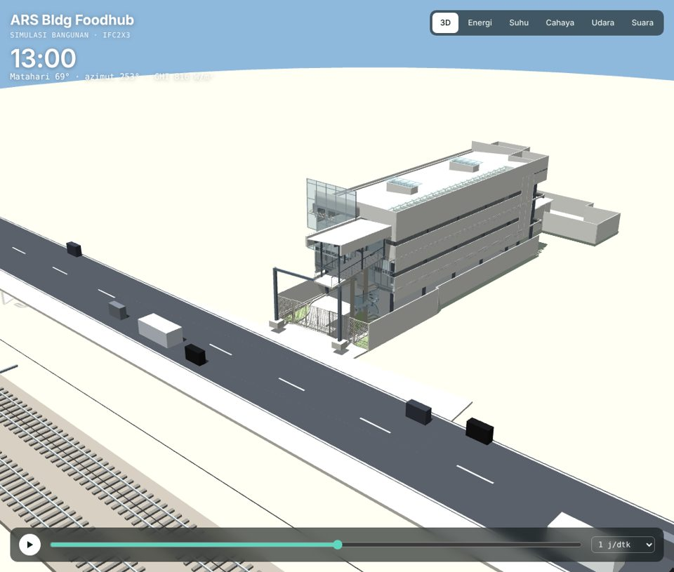
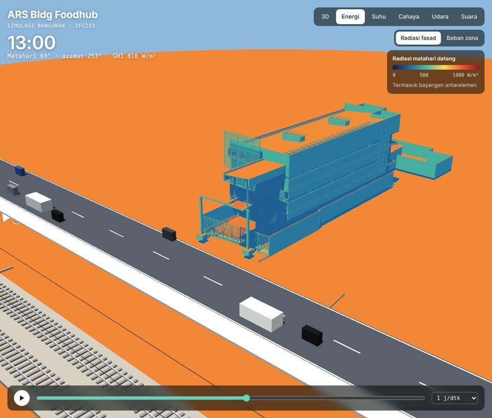
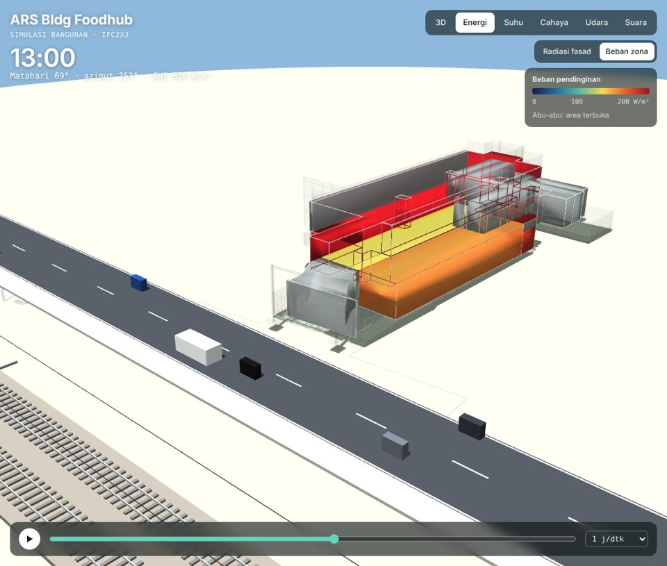
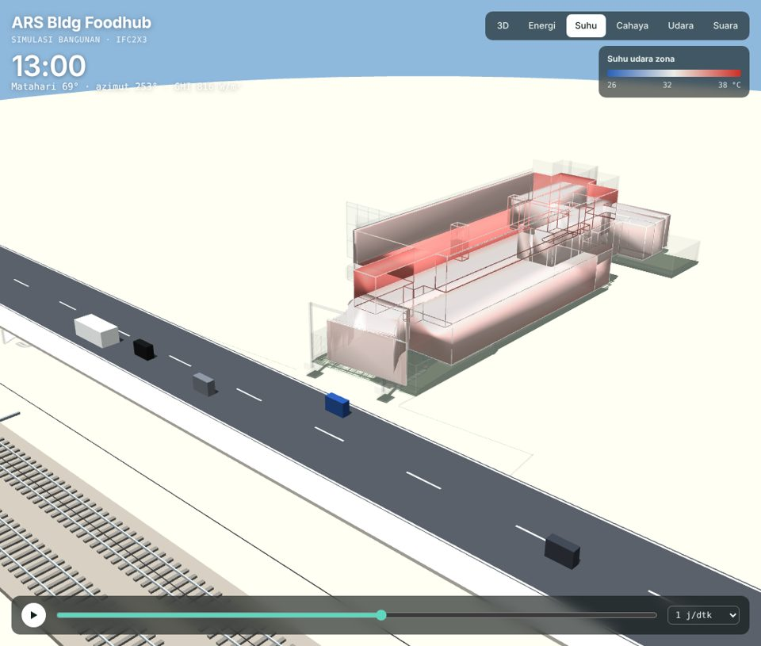
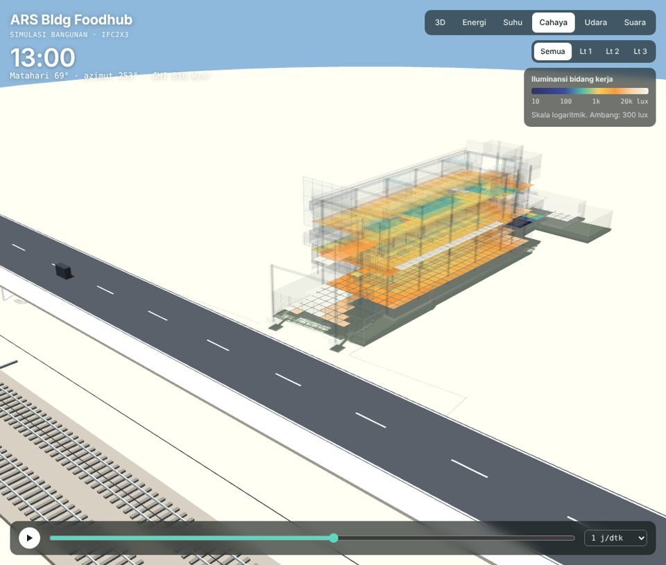
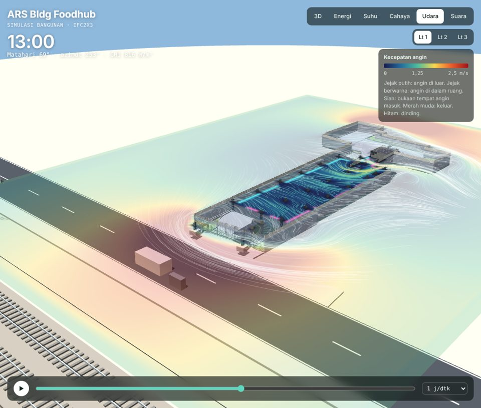
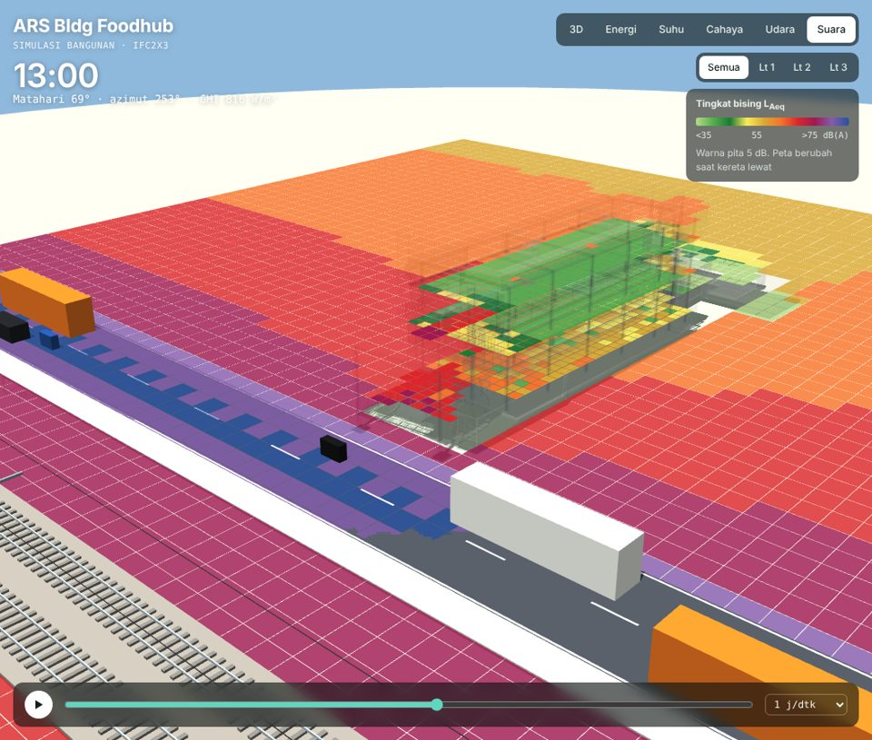

# 6D Dashboard

Aplikasi web interaktif yang mengubah model BIM (IFC) gedung **ARS Bldg Foodhub** menjadi model 3D beranimasi dengan enam tampilan analisis: energi, suhu ruang, pencahayaan alami, sirkulasi udara, dan kebisingan lengkap dengan suara 3D.

Semua simulasi berjalan langsung di browser. Tidak perlu server khusus, database, atau proses build.

**Demo:** `https://<nama-pengguna>.github.io/<nama-repositori>/`



## Fitur

| Tab | Isi |
|---|---|
| **3D** | Model IFC utuh dengan bayangan matahari, jalan raya dua arah, rel kereta berlistrik, serta kendaraan dan kereta yang bergerak |
| **Energi** | Peta radiasi matahari pada fasad (dengan bayangan) dan beban pendinginan AC per zona |
| **Suhu** | Suhu udara tiap zona dengan ventilasi alami, tanpa AC |
| **Cahaya** | Peta lux di bidang kerja 0,75 m yang bergerak mengikuti matahari, sDA, dan potensi hemat energi lampu |
| **Udara** | Aliran angin Lattice Boltzmann waktu nyata, partikel yang masuk ke ruang, bukaan masuk dan keluar, serta pergantian udara (ACH) |
| **Suara** | Peta bising dari jalan dan rel, dan suara 3D (HRTF) kendaraan, kereta, klakson, serta bel palang pintu |

Kontrol umum:

- **Pita waktu:** putar, jeda, atau geser jam dalam sehari, dengan kecepatan 0,5 hingga 4 jam per detik.
- **Bulan:** pilih bulan untuk mengubah posisi matahari dan iklim.
- **Per lantai:** potong denah per lantai untuk tab Cahaya, Udara, dan Suara.
- **Inspeksi:** arahkan kursor ke model untuk membaca nilai di titik itu (lux, m/s, dB, suhu, beban); klik zona untuk detailnya.

## Tangkapan layar

| Energi: radiasi fasad | Energi: beban zona |
|---|---|
|  |  |
| **Suhu ruang** | **Pencahayaan alami** |
|  |  |
| **Sirkulasi udara** | **Kebisingan** |
|  |  |

## Menjalankan di komputer sendiri

Klik ganda `index.html`, atau jalankan server lokal dari folder proyek:

```bash
python -m http.server 8000
```

Lalu buka http://localhost:8000.

## Menerbitkan dengan GitHub Pages

1. Unggah seluruh isi folder ini ke repositori, dengan `index.html` di akar.
2. Buka **Settings › Pages**.
3. Pada **Source**, pilih **Deploy from a branch**, cabang `main`, folder `/ (root)`, lalu simpan.
4. Setelah satu atau dua menit, situs tersedia di `https://<nama-pengguna>.github.io/<nama-repositori>/`.

Situs ini juga bisa diterbitkan di Netlify, Vercel, Cloudflare Pages, atau hosting biasa dengan mengunggah isi folder apa adanya.

## Struktur folder

```
.
├── index.html            Halaman utama
├── css/style.css         Tampilan
├── js/app.js             Viewer 3D, semua simulasi, dan audio
├── js/data.js            Geometri dan data hasil olahan IFC (±1,8 MB)
├── vendor/               three.js r147 dan OrbitControls (lisensi MIT)
└── docs/screenshots/     Gambar untuk README
```

## Cara kerja

File `ARS_Bldg_Foodhub.ifc` (IFC2X3, Revit 2024) diolah terlebih dahulu dengan Python:

1. **Geometri:** IfcOpenShell mentriangulasi semua elemen, lalu permukaan dikelompokkan dari materialnya (dinding, kaca, polikarbonat, mesh, atap, struktur).
2. **Zona:** 15 IfcSpace bervolume menjadi zona termal. Selubung tiap zona dideteksi dengan raycast (trimesh dan Embree).
3. **Pra-hitung:** sinar langit dan matahari untuk 969 titik cahaya, grid rintangan aliran udara per lantai, serta atenuasi bising dari jalan dan rel untuk 4.654 titik.
4. **Ekspor:** hasilnya dikompres ke `js/data.js`. Sisanya dihitung waktu nyata di browser.

| Analisis | Metode di browser |
|---|---|
| Energi dan suhu | Model termal satu simpul udara + massa per zona, langkah 1 menit, iklim Jakarta |
| Radiasi fasad | Shader GPU dengan peta bayangan matahari |
| Cahaya | Data sinar langit dan matahari hasil pra-hitung, dikonversi ke lux |
| Udara | Lattice Boltzmann D2Q9 pada irisan 1,2 m, sel 0,5 m |
| Suara | Sumber garis jalan dan rel, Web Audio API dengan HRTF dan efek Doppler |

## Hasil ringkas (21 Oktober, iklim Jakarta)

| Indikator | Hasil |
|---|---|
| Listrik AC bila 6 zona tertutup didinginkan | 518 kWh/hari, puncak 188 kW |
| Suhu maksimum tanpa AC | 36,9 °C |
| sDA 300 lux | 100% luas zona tertutup |
| Pergantian udara Lantai 1, angin utara/selatan 2 m/s | 59 hingga 70 ACH |
| Bising fasad depan (barat), 13.00 | 72 dB(A), di atas baku 70 dB(A) |
| Bising rata-rata dalam ruang | 48 dB(A), sekitar 59 dB(A) saat kereta lewat |

## Asumsi dan keterbatasan

Semua angka adalah **estimasi tahap konsep** untuk membandingkan opsi desain, bukan untuk perhitungan teknis atau sertifikasi.

- **Lokasi:** lokasi pada IFC masih bawaan Revit, sehingga dipakai iklim Jakarta (6,2° LS) dengan data rata-rata bulanan.
- **Material:** nilai U, SHGC, dan transmitansi memakai angka umum karena IFC tidak memuat sifat termal material.
- **Site:** jalan raya ditempatkan di atas pelat jalan pada IFC (sisi barat). Posisi rel kereta adalah asumsi, 20 m di barat as jalan.
- **Udara:** aliran dihitung 2D per lantai, tanpa aliran vertikal dan efek cerobong.
- **Cahaya:** pantulan dalam ruang hanya didekati.
- **Suara:** belum memperhitungkan pantulan dan serapan tanah.

Asumsi lengkap ada di bagian "Asumsi model" pada panel tiap tab.

## Rencana pengembangan

- Simulasi di server: EnergyPlus untuk energi dan suhu, Radiance untuk cahaya, OpenFOAM untuk CFD 3D, dan NoiseModelling untuk kebisingan.
- Unggah IFC langsung dari browser untuk memproses gedung lain.
- Mengganti asumsi dengan data nyata: posisi rel, spesifikasi material, jadwal operasional, dan koordinat site.

## Teknologi

[three.js](https://threejs.org) r147 · Web Audio API · Python · [IfcOpenShell](https://ifcopenshell.org) · [trimesh](https://trimesh.org) · Embree · Playwright

## Kontribusi dan kredit

- Model BIM: ARS Bldg Foodhub (Autodesk Revit 2024).
- Aplikasi web dan simulasi disusun dengan bantuan Claude (Anthropic).

## Lisensi

three.js dan OrbitControls berlisensi MIT (lihat `vendor/LICENSE-three.txt`). Lisensi untuk kode aplikasi dan model gedung belum ditentukan; tambahkan file `LICENSE` sesuai keputusan pemilik proyek.
